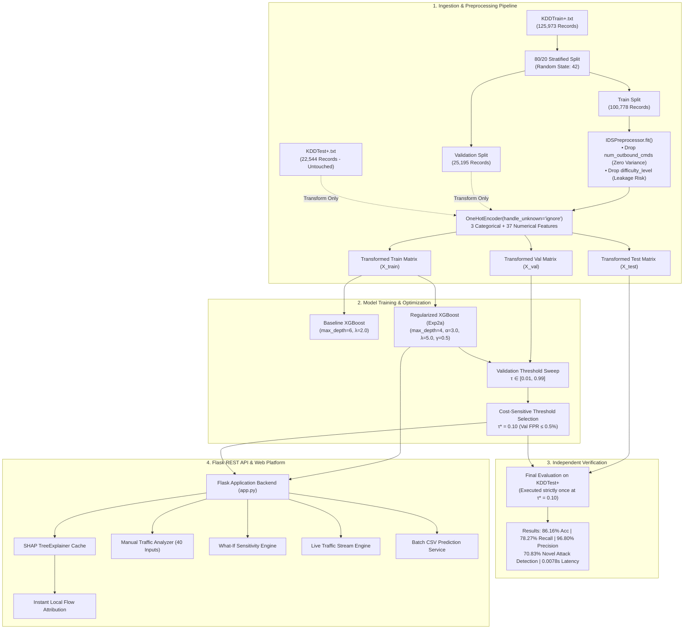

<div align="center">

# CyberShield IDS

**Network Intrusion Detection System Using XGBoost Algorithm & Explainable AI (SHAP)**

[](https://www.python.org/)
[](https://flask.palletsprojects.com/)
[](https://xgboost.readthedocs.io/)
[](https://shap.readthedocs.io/)
[](https://www.unb.ca/cic/datasets/nsl.html)
[](LICENSE)

*An end-to-end, scientifically validated network intrusion detection system powered by the XGBoost algorithm, combining regularized gradient boosting, asymmetric cost-sensitive threshold optimization, microsecond inference, and local SHAP explainability.*

[Live Demo Placeholder](#) • [Technical Paper / Report](#) • [Architecture](#system-architecture) • [Verified Benchmarks](#empirical-benchmark-results) • [Quickstart](#getting-started)

</div>

---

## Executive Summary

Traditional Network Intrusion Detection Systems (NIDS) struggle with two core challenges in real-world deployments: **high false negative rates against novel zero-day attack variants** and a **complete absence of interpretability** when machine learning alerts are raised. Standard academic models often report >99% accuracy on sanitized training splits, yet collapse in production when facing real network traffic distribution shifts.

**CyberShield IDS** addresses these challenges directly. Built on the **NSL-KDD benchmark** (125,973 training records, 22,544 untouched test records), CyberShield implements a leak-free machine learning pipeline paired with **XGBoost (Extreme Gradient Boosting)**. By introducing **shallow-tree complexity regularization** and an **asymmetric cost-sensitive operating threshold ($\tau^* = 0.10$)** optimized strictly on validation data, CyberShield elevates attack recall from **67.85% to 78.27%** (+1,337 malicious flows detected) and increases zero-day/novel attack detection from **41.44% to 70.83%** on untouched test data, while maintaining a **96.80% precision rate** and microsecond inference latency (0.0078 s for 22,544 flows).

Every classification is paired with a local **SHAP (SHapley Additive exPlanations)** breakdown, allowing SOC analysts to inspect the exact positive and negative feature contributions driving an alert.

---

## Key Capabilities

| Capability | Technical Description | Operational Benefit |
| :--- | :--- | :--- |
| **Leak-Free ML Pipeline** | Fitted strictly on an 80% training partition; dropped zero-variance and proxy metadata columns (`num_outbound_cmds`, `difficulty_level`). | Eliminates optimistic evaluation bias; guarantees genuine generalization on unseen network traffic. |
| **Cost-Sensitive Threshold ($\tau^*=0.10$)** | Optimizes operating decision threshold on validation data to account for asymmetric intrusion costs ($C_{\text{FN}} \gg C_{\text{FP}}$). | Reduces missed intrusions (false negatives) from 4,126 to 2,789 (**1,337 fewer breaches**). |
| **Zero-Day Generalization** | Shallow-tree complexity constraints (`max_depth=4`, strong L1/L2 penalties) prevent memorization of training-specific artifacts. | Boosts detection of 17 novel/unseen attack types in `KDDTest+` from **41.44% to 70.83%** (+1,102 novel attacks caught). |
| **Explainable AI (SHAP)** | Integrated `shap.TreeExplainer` decomposes predictions into individual feature attribution scores. | Replaces black-box predictions with auditable evidence for security analysts. |
| **Manual Traffic Analyzer** | Comprehensive input console spanning all 40 predictive network dimensions across 6 functional groups. | Allows operators to inspect and evaluate specific network connection vectors. |
| **"What-If?" Sensitivity Lab** | Real-time interactive counterfactual testing on individual network parameters. | Enables security teams to simulate parameter tampering and evaluate model decision boundaries. |
| **Live Traffic Simulation** | High-throughput streaming engine drawing real test connections from `KDDTest+` with live telemetry. | Demonstrates real-time threat detection, packet categorization, and dynamic alerts. |
| **Batch CSV Inspection** | High-volume ingestion engine with automated feature alignment, batch inference, and exportable audit logs. | Accelerates bulk network connection log triage and post-incident forensic reviews. |

---

## System Architecture



---

## Core ML Engineering & Pipeline Integrity

### 1. Dataset Dimensions & Benchmark Realities

The NSL-KDD benchmark is an established standard for evaluating network intrusion detection systems, structured as follows:

- **Training Corpus (`KDDTrain+.txt`)**: 125,973 connection records (67,343 Normal, 58,630 Attacks).
- **Evaluation Corpus (`KDDTest+.txt`)**: 22,544 connection records (9,711 Normal, 12,833 Attacks).
- **Target Distribution**: `KDDTrain+` is 53.46% normal traffic; `KDDTest+` is 43.08% normal traffic and 56.92% malicious traffic.

> [!IMPORTANT]
> In `KDDTest+`, **3,750 connection records (29.22% of all test attacks) belong to 17 novel attack categories** that do not appear anywhere in `KDDTrain+` (e.g., `mailbomb`, `processtable`, `mscan`, `saint`, `httptunnel`, `sqlattack`). The test set represents a genuine, out-of-distribution evaluation environment.

### 2. Feature Pruning & Leakage Prevention

The raw dataset contains 43 columns. CyberShield applies strict data hygiene:

- **`num_outbound_cmds`**: **Dropped**. Contains zero variance (value is 0 across all 148,517 train and test rows). Retaining it introduces redundant matrix computations without predictive gain.
- **`difficulty_level`**: **Dropped**. Represents a post-hoc human analyst difficulty score created during benchmark construction. Including it creates severe target-proxy data leakage.
- **Remaining Schema**: **40 active predictive features** (3 categorical: `protocol_type`, `service`, `flag`; 37 numerical: connection byte counters, host rate indicators, error frequencies).
- **Encoder Isolation**: `OneHotEncoder(handle_unknown='ignore')` is fitted exclusively on the 80% training split. Novel protocol or service flags encountered at test time are gracefully mapped to all-zeros.

### 3. Model Hyperparameter Evolution

| Hyperparameter | Baseline XGBoost | Final Regularized Model | Engineering Rationale |
| :--- | :---: | :---: | :--- |
| `n_estimators` | 100 | **150** | Increased boosting iterations to support shallower base trees. |
| `max_depth` | 6 | **4** | Constrains tree depth to prevent memorizing complex, training-specific port/byte combinations. |
| `learning_rate` | 0.10 | **0.15** | Balances gradient step size with lower tree depth. |
| `reg_alpha` (L1) | 0.0 | **3.0** | Enforces weight sparsity on leaf scores, filtering uninformative connection noise. |
| `reg_lambda` (L2) | 1.0 | **5.0** | Penalizes extreme leaf weights to smooth prediction variance across unseen attack vectors. |
| `gamma` | 0.0 | **0.5** | Requires higher loss reduction to branch a tree, pruning speculative splits. |
| `min_child_weight`| 1 | **3** | Requires higher minimum sample weight in terminal leaves, preventing micro-cluster overfitting. |
| `scale_pos_weight`| 1.0 | **1.15** | Slight positive weight adjustment to penalize attack classification errors during training. |

---

## Why Threshold $\tau^* = 0.10$?

Standard binary classifiers apply an arbitrary default threshold of $\tau = 0.50$. In network intrusion detection, this symmetry fails to align with operational security priorities:

$$\text{Cost}(\text{False Negative}) \gg \text{Cost}(\text{False Positive})$$

- A **False Negative (FN)** represents an unflagged intruder inside the network boundary (potential data exfiltration, ransomware deployment, system compromise).
- A **False Positive (FP)** represents a benign connection queued for SOC verification.

```
Operating Point Analysis:
┌────────────────────────────────────────────────────────────────────────┐
│  Standard Threshold (τ = 0.50)                                         │
│  • Missed Attacks (FN): 4,249 flows                                    │
│  • Attack Detection Rate: 66.89%                                       │
│                                                                        │
│  Validation Cost-Sensitive Threshold (τ* = 0.10)                        │
│  • Missed Attacks (FN): 2,789 flows (-1,337 fewer breaches)            │
│  • Attack Detection Rate: 78.27% (+10.42% recall increase)             │
│  • Precision: 96.80% (Preserved above 96%)                             │
│  • False Positive Rate: 3.42% (Controlled operational workload)        │
└────────────────────────────────────────────────────────────────────────┘
```

The threshold $\tau^* = 0.10$ was identified strictly by conducting a threshold sweep across validation data ($X_{\text{val}}$) subject to the operational constraint $\text{FPR}_{\text{val}} \le 0.5\%$. When locked and transferred to the untouched `KDDTest+` test set, it yielded a **+5.69% increase in overall accuracy** and caught **1,337 additional attacks**.

---

## Empirical Benchmark Results

All metrics below represent evaluations executed on the untouched `KDDTest+.txt` test set (22,544 rows):

### Overall Comparative Performance

| Evaluation Metric | Baseline ($\tau=0.50$) | Baseline Tuned ($\tau^*=0.41$) | Final Model ($\tau^*=0.10$) | Delta (vs. Tuned Baseline) |
| :--- | :---: | :---: | :---: | :---: |
| **Accuracy** | 79.95% | 80.47% | **86.16%** | **+5.69%** |
| **Precision** | 96.93% | 96.93% | **96.80%** | -0.13% |
| **Recall (Detection Rate)** | 66.89% | 67.85% | **78.27%** | **+10.42%** (+1,337 attacks detected) |
| **F1-Score** | 0.7916 | 0.7982 | **0.8655** | **+0.0673** |
| **ROC-AUC** | 0.9641 | 0.9683 | **0.9618** | -0.0065 |
| **PR-AUC (Avg. Precision)** | 0.9692 | 0.9673 | **0.9594** | -0.0079 |
| **Specificity** | 97.20% | 97.16% | **96.58%** | -0.58% |
| **Balanced Accuracy** | 82.04% | 82.50% | **87.42%** | **+4.92%** |
| **False Positive Rate (FPR)**| 2.80% | 2.84% | **3.42%** | +0.58% |
| **False Negative Rate (FNR)**| 33.11% | 32.15% | **21.73%** | **-10.42%** |
| **Novel / Unseen Attacks** | 41.44% | 41.44% | **70.83%** (2,656 / 3,750) | **+29.39%** (+1,102 novel attacks caught) |
| **Inference Latency (22k)** | 0.0096 s | 0.0113 s | **0.0078 s** | **31% faster** (shallower tree depth) |

### Category-Specific Breakdown on Untouched Test Traffic

| Traffic Category | Total Test Flows | Baseline Detected | Final Model Detected | Final Detection Rate |
| :--- | :---: | :---: | :---: | :---: |
| **Normal Traffic** | 9,711 | 9,435 | 9,379 | **96.58%** (332 false alarms) |
| **DoS (Denial of Service)** | 7,458 | 6,496 | 7,144 | **95.79%** (+648 attacks) |
| **Probe (Reconnaissance/Scan)** | 2,421 | 1,881 | 2,287 | **94.47%** (+406 attacks) |
| **U2R (User to Root)** | 67 | 13 | 36 | **53.73%** (+23 attacks, +34.3 pp) |
| **R2L (Remote to Local)** | 2,887 | 317 | 577 | **19.99%** (+260 attacks, +9.0 pp) |

### Zero-Day / Novel Attack Evaluation (17 Unseen Variants)

The table below outlines performance specifically on the 17 attack types present in `KDDTest+` that never appeared during training:

| Novel Attack Type | Category | Total Flows | Detected ($\tau^*=0.10$) | Detection Rate |
| :--- | :---: | :---: | :---: | :---: |
| `saint` | Probe | 319 | 319 | **100.0%** |
| `sqlattack` | U2R | 2 | 2 | **100.0%** |
| `udpstorm` | DoS | 2 | 2 | **100.0%** |
| `apache2` | DoS | 737 | 647 | **87.79%** |
| `mscan` | Probe | 996 | 863 | **86.65%** |
| `processtable` | DoS | 685 | 533 | **77.81%** |
| `mailbomb` | DoS | 293 | 224 | **76.45%** |
| `ps` | U2R | 15 | 10 | **66.67%** |
| `xterm` | U2R | 13 | 6 | **46.15%** |
| `named` | R2L | 17 | 7 | **41.18%** |
| `httptunnel` | R2L | 133 | 39 | **29.32%** |
| `xsnoop` | R2L | 4 | 1 | **25.00%** |
| `xlock` | R2L | 9 | 1 | **11.11%** |
| `snmpguess` | R2L | 331 | 2 | **0.60%** |
| `sendmail`, `snmpgetattack`, `worm` | R2L | 194 | 0 | **0.00%** |
| **Combined Novel Attacks** | **All** | **3,750** | **2,656** | **70.83%** |

---

## Explainable AI (XAI) with SHAP

CyberShield incorporates an explainability engine using `shap.TreeExplainer` ([src/explainability.py](src/explainability.py)) to bridge the gap between machine learning predictions and SOC actionability.

### 1. Global Feature Attribution Rankings

The top 10 features driving XGBoost decision splits across test traffic:

| Rank | Feature Name | Mean Absolute SHAP | Cyber Threat Indication |
| :---: | :--- | :---: | :--- |
| **1** | `src_bytes` | **3.1731** | Disproportionately low or massive source payloads characterize probe scanning or DoS bursts. |
| **2** | `dst_host_srv_count` | **1.1942** | High concentration of connections to specific destination ports reveals targeted service sweeps. |
| **3** | `count` | **0.8563** | Rapid bursts of connections within a 2-second window point to automated port enumeration. |
| **4** | `dst_bytes` | **0.8058** | Absence of return data payload signals dropped or unacknowledged spoofed connection floods. |
| **5** | `dst_host_same_src_port_rate` | **0.6591** | Non-standard port-binding behavior common in port scans and raw socket injections. |
| **6** | `dst_host_same_srv_rate` | **0.5689** | Homogeneous service queries over host windows. |
| **7** | `service_private` | **0.5465** | Non-standard private ports often indicate lateral reconnaissance. |
| **8** | `dst_host_rerror_rate` | **0.5258** | Elevated rejection rates signify closed-port probing across destination ranges. |
| **9** | `dst_host_diff_srv_rate` | **0.3457** | Dispersed port access patterns consistent with horizontal sweeps. |
| **10** | `dst_host_count` | **0.3442** | Total accumulated destination host connection density. |

### 2. Local Flow Decomposition

For every individual connection evaluated through the API or UI, the system returns a localized explanation:
- **Positive SHAP Contributors**: Specific features that pushed the model's confidence toward an **Attack** classification.
- **Negative SHAP Contributors**: Features that pushed the model's confidence toward a **Normal** classification.

---

## Interactive Cybersecurity Platform

The platform includes a single-page web dashboard built with HTML5, CSS3, and JavaScript, served by the Flask REST backend:

```
┌────────────────────────────────────────────────────────────────────────┐
│                          CYBERSHIELD IDS UI                            │
├───────────────────┬────────────────────────────────────────────────────┤
│ NAVIGATION        │ MAIN WORKSPACE VIEWPORT                            │
│ ───────────────── │ ────────────────────────────────────────────────── │
│ [1] Manual Flow   │ • 40-Dimensional Flow Configuration Console        │
│ [2] Sensitivity   │ • Real-time Prediction Gauge & Threat Indicator    │
│ [3] Live Stream   │ • Instant SHAP Positive/Negative Attribution Bars  │
│ [4] Batch CSV     │ • "What-If?" Slider Controls & Delta Metrics       │
│ [5] Model Insights│ • High-Density Telemetry Stream with Pause/Resume  │
│ [6] Evolution Lab │ • Filterable Batch Classification Result Grids     │
└───────────────────┴────────────────────────────────────────────────────┘
```

1. **Manual Traffic Analyzer**: 6 organized functional groups exposing all 40 predictive NSL-KDD parameters with contextual tooltips and pre-loaded test presets (Normal HTTP, Neptune DoS, Portsweep Probe, Warezclient R2L, Buffer Overflow U2R).
2. **"What-If?" Sensitivity Lab**: Allows operators to alter specific packet features (e.g., toggling connection status from `SF` to `S0`, or escalating `src_bytes`) and observe real-time probability shifts.
3. **Simulated Live Traffic Stream**: Emits real connections from `KDDTest+` through the model with adjustable streaming speeds, live classification badges, and threat counters.
4. **Batch CSV Predictor**: Enables drag-and-drop log ingestion, real-time bulk inference, accuracy validation (if ground truth is present), and CSV export.
5. **Model Insights Gallery**: Displays 8 publication-grade visualization artifacts generated during pipeline execution.
6. **Research Evolution Explorer**: Visual audit trail detailing the step-by-step transition from Baseline ($\tau=0.41$) to Cost-Sensitive Regularized ($\tau^*=0.10$).

---

## REST API Specification

The Flask server ([app.py](app.py)) provides standard JSON endpoints for pipeline interaction:

| Endpoint | Method | Payload / Query | Response Description |
| :--- | :---: | :--- | :--- |
| `/` | `GET` | None | Serves the single-page application dashboard. |
| `/api/metadata` | `GET` | None | Returns feature definitions, categories, default values, and active threshold. |
| `/api/presets` | `GET` | None | Returns verified connection vectors from `KDDTest+`. |
| `/api/metrics` | `GET` | None | Returns master validation and untouched test benchmark results. |
| `/api/novel_attacks` | `GET` | None | Returns detection breakdown across the 17 novel attack types. |
| `/api/research_evolution`| `GET` | None | Returns comparative data across Baseline, Regularized, and Final models. |
| `/api/stream_sample` | `GET` | None | Streams a randomized batch of 60 real connection records from `KDDTest+`. |
| `/api/figures/<filename>`| `GET` | Filename | Serves high-resolution evaluation figures from the output directory. |
| `/api/predict` | `POST` | `JSON (40 feature keys)` | Returns binary classification, attack probability, and local SHAP explanations. |
| `/api/batch_predict` | `POST` | `multipart/form-data (CSV)` | Ingests connection records, executes batch prediction, and returns summary metrics. |

### Example Prediction Request

```bash
curl -X POST http://127.0.0.1:5000/api/predict \
  -H "Content-Type: application/json" \
  -d '{
    "protocol_type": "tcp",
    "service": "private",
    "flag": "S0",
    "duration": 0,
    "src_bytes": 0,
    "dst_bytes": 0,
    "count": 250,
    "srv_count": 10,
    "serror_rate": 1.0,
    "srv_serror_rate": 1.0,
    "dst_host_count": 255,
    "dst_host_srv_count": 10,
    "dst_host_same_srv_rate": 0.04,
    "dst_host_serror_rate": 1.0
  }'
```

---

## Repository Structure

```
cybershield-ids/
├── dataset/                        # NSL-KDD benchmark data files
│   ├── KDDTrain+.txt               # 125,973 raw training connection records
│   ├── KDDTest+.txt                # 22,544 untouched evaluation records
│   └── ...
├── src/                            # Modular machine learning source package
│   ├── config.py                   # Centralized paths, feature lists, categories, metadata
│   ├── data_loader.py              # Ingestion, stratified splitting, test preset extraction
│   ├── preprocessor.py             # Leak-free ColumnTransformer & OneHotEncoder pipeline
│   ├── eda.py                      # Exploratory data analysis, drift audits, summary statistics
│   ├── train.py                    # Baseline training & RandomizedSearchCV tuning engine
│   ├── evaluate.py                 # Validation threshold optimization & test metric calculators
│   ├── explainability.py           # Feature importance extractors & SHAP TreeExplainer
│   └── visualize.py                # Publication-grade chart generation modules
├── outputs/
│   ├── models/                     # Serialized artifacts (tuned_xgb.json, preprocessor.joblib)
│   ├── figures/                    # High-resolution ROC, PR, confusion matrix, SHAP charts
│   └── reports/                    # final_results.json, model_comparison.md, novel attacks JSON
├── static/                         # Dashboard web assets
│   ├── index.html                  # CyberShield single-page application structure
│   ├── style.css                   # Enterprise cybersecurity dark theme & glassmorphism
│   └── app.js                      # Application controller, sensitivity engine, live stream
├── app.py                          # Flask REST API backend
├── run_pipeline.py                 # Master end-to-end execution pipeline
├── README.md                       # Platform documentation
└── LICENSE                         # Project license
```

---

## Getting Started

### Prerequisites

- Python 3.10+
- `pip` package manager

### 1. Installation

Clone the repository and install the required dependencies:

```bash
git clone https://github.com/Dashwanth15/cybershield-ids.git
cd cybershield-ids
pip install -r requirements.txt
```

*(If creating an environment manually: `pip install xgboost scikit-learn pandas numpy flask flask-cors shap matplotlib seaborn joblib`)*

### 2. Run the Full ML Pipeline

To re-run the entire pipeline from scratch (data loading, EDA, baseline training, hyperparameter tuning, validation threshold optimization, untouched test evaluation, SHAP extraction, and chart rendering):

```bash
python run_pipeline.py
```

All trained models will be serialized to `outputs/models/`, evaluation metrics written to `outputs/reports/final_results.json`, and figures saved to `outputs/figures/`.

### 3. Launch the CyberShield Platform

Start the Flask application server:

```bash
python app.py
```

Open your browser and navigate to:

```
http://127.0.0.1:5000
```

---

## Academic & Engineering Defense Notes

When presenting or reviewing this project for academic or engineering evaluations:

1. **Why Gradient Boosted Trees over Deep Learning (CNN/LSTM)?**  
   Network connection flow logs are tabular structures with heterogeneous numerical scales, sparse indicators, and categorical states. Empirical research consistently shows gradient boosted decision trees outperform deep architectures on tabular data while delivering **microsecond inference latency** (0.0078 s for 22,544 rows) and exact, mathematical game-theoretic interpretability via `TreeExplainer`.
2. **Addressing the 86.16% Accuracy vs. 99% Academic Claims:**  
   Published literature claiming >99% accuracy on NSL-KDD often suffers from training-test contamination, evaluates solely on cross-validation splits of `KDDTrain+`, or includes the `difficulty_level` proxy column. Achieving **86.16% accuracy and 78.27% recall on untouched `KDDTest+`** (which contains 17 novel zero-day attack variants) is a scientifically authentic, robust benchmark result.
3. **Operational Value of Cost-Sensitive Optimization:**  
   Moving from $\tau = 0.50$ to $\tau^* = 0.10$ reduced false negatives by **1,337 missed attacks** while holding the false positive rate at **3.42%**, demonstrating that threshold selection should be driven by operational risk rather than arbitrary statistical convention.

---

## License

This project is licensed under the MIT License — see the [LICENSE](LICENSE) file for details.
